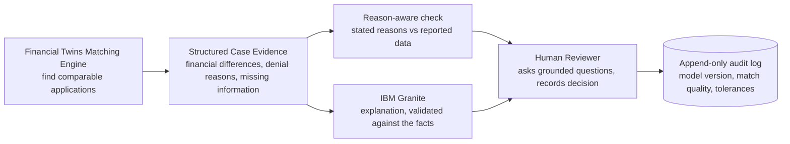

# Architecture

```mermaid
flowchart TD
    A[HMDA 2025 LAR - Maryland<br/>FFIEC Data Browser API] --> B[Preprocess + cohort filter<br/>src/data/preprocess.py]
    B --> C1[applications<br/>financial matching features only]
    B --> C2[audit_only<br/>race / ethnicity / sex / age]
    B --> C3[denial_context<br/>reasons + AUS ids - display only]
    C1 --> M

    subgraph LNX["IBM LinuxONE VM (s390x) - Ubuntu, 3 vCPU"]
      M[Constrained financial-twin matching<br/>+ review priority score]
      F[Blind fairness audit<br/>match on finances -> then reveal]
      S[Model Sensitivity Analysis<br/>logreg + XGBoost]
      API[FastAPI :8000 (3 workers)<br/>token-gated demographic endpoints<br/>audit log]
      subgraph CT["Provided JupyterLab container"]
        G[IBM Granite 4.0-H 350M base<br/>llama.cpp - note server :8001]
      end
      M --> API
      F --> API
      S --> API
      C2 -.only after matching.-> F
      C2 -.-> S
      API <-->|facts JSON -> note, validated| G
    end

    X[SHED 2025 survey<br/>weighted context] --> API
    Y[ACS 2024 5-yr county context] --> API
    API -->|SSH tunnel :22| UI[Streamlit dashboard<br/>7 pages]
    UI --> R[Human reviewer: no automatic decisions]
```

## Review workflow (core innovation)

Granite receives only the structured facts (counts, match quality, field names, stated reason names) - no dollar amounts, no demographics. Decisions are limited to three advisory options; the API rejects anything else (tested).

## Components
- **Data separation (leak control):** matching code reads only `applications`; demographics are joined after matching (fairness) or only in the labelled sensitivity analysis. A test enforces this.
- **API** (`src/api/main.py`): `/health /summary /lenders /review-queue /application/{id} /application/{id}/twins /analyse-application (SIMULATION) /generate-review-note /fairness-report* /model-sensitivity* /context/shed /context/census /metrics`. *Require `X-Audit-Token`.
  Every response carries `X-Process-Ms`; the audit log (`audit_log.jsonl`) records version, event and latency only, no demographics or financials.
- **Granite** (`src/explainability/`): facts JSON -> few-shot prompt -> Granite -> validator (no invented numbers, no accusatory wording) -> template fallback; validated notes are cached. Server runs in the lab container; the host API reaches it via `docker exec ... curl` (`SL_GRANITE_CMD`).
- **Services:** `scripts/secondlook-api.service`, `scripts/secondlook-granite.service` (systemd; restart on failure, survive reboot as long as the lab container is up).

## Why LinuxONE fits this workload (and what we measured, not assumed)
- **Data stays in a controlled backend:** matching, scoring, the demographic audit and the generative step all run on the VM; the Granite step sees only de-identified structured facts; demographic endpoints are token-gated; logs hold no financials or demographics; the only internet exposure is SSH.
- **One platform for the whole workflow:** predictive ML (matching, XGBoost), generative AI (Granite in the provided container) and the API run side by side with containers + systemd.
- **Throughput:** matching is precomputed once (batch audit of 37,491 applications in under a second for the same-lender scope) and interactive analysis is on demand (~4 ms median); notes are cached because Granite is slow. Measured numbers are in `docs/model_evaluation.md`.
- **Not claimed:** that LinuxONE was faster than a laptop (it was not), or hardware acceleration (zDNN initialises but offload was no faster).

## What runs where / what is and is not claimed
- LinuxONE: matching, scoring, fairness audit, XGBoost sensitivity model, Granite notes, API. Same results as on arm64 (identical digests).
- The VM was *slower* than a laptop for the matching workload; no speed-up is claimed. llama.cpp initialises the zDNN/NNPA backend, but offloading was measured *slower* for this model, so it is off. CPU flags list `nnpa`; our NumPy code does not use it.

## Network
Only ports 22 (SSH) and 38888 (the lab's Jupyter) are reachable from the internet; the VM firewall accepts everything, so port 8000 is filtered upstream and cannot be opened from inside the VM.
Use an SSH tunnel: `ssh -i wise_key.pem -N -L 18000:localhost:8000 linux1@<host>` then `SL_API_URL=http://localhost:18000 AUDIT_TOKEN=... streamlit run dashboard/app.py`.
